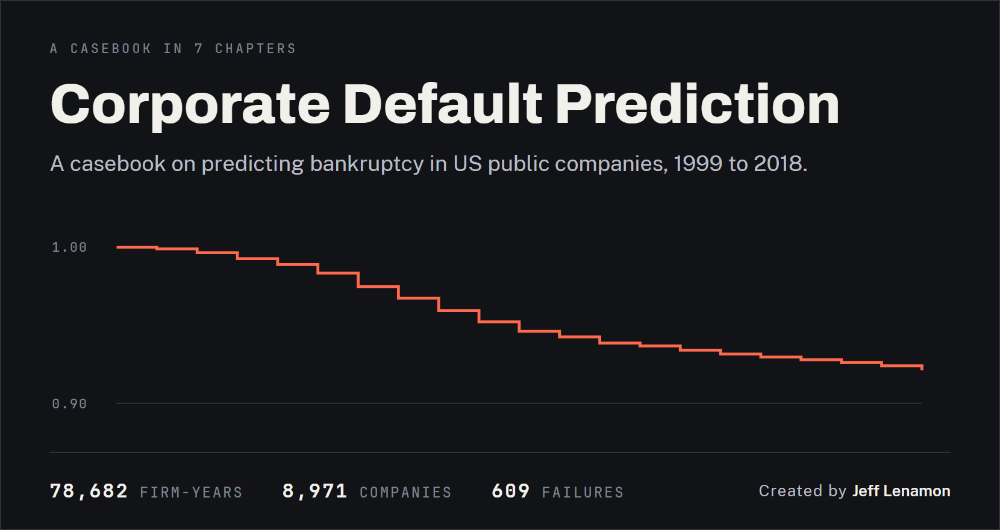
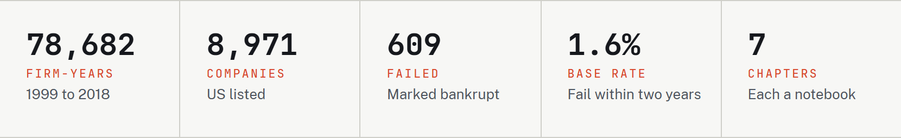
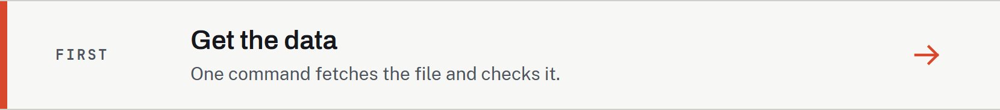
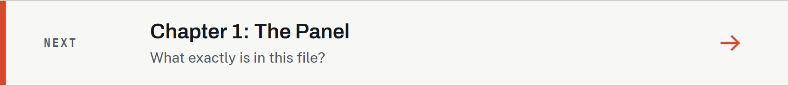
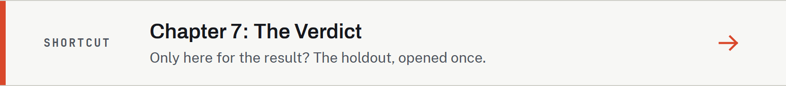
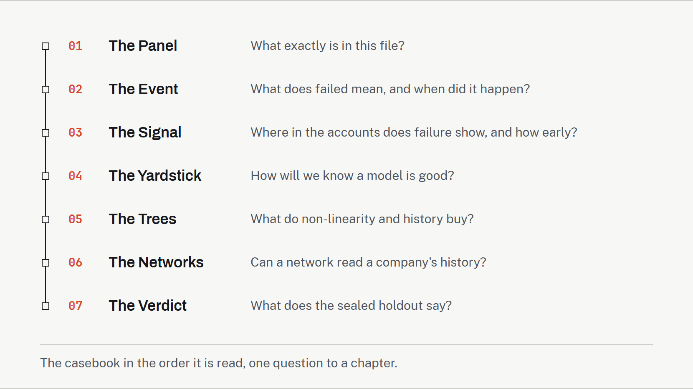
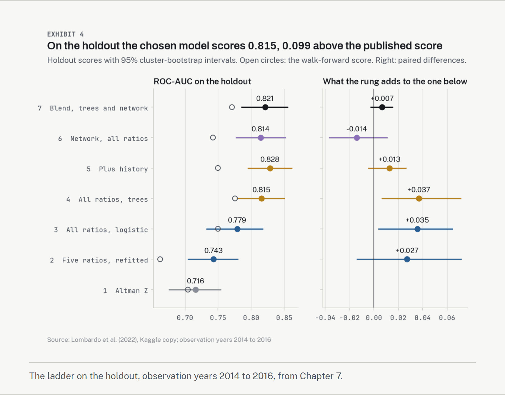
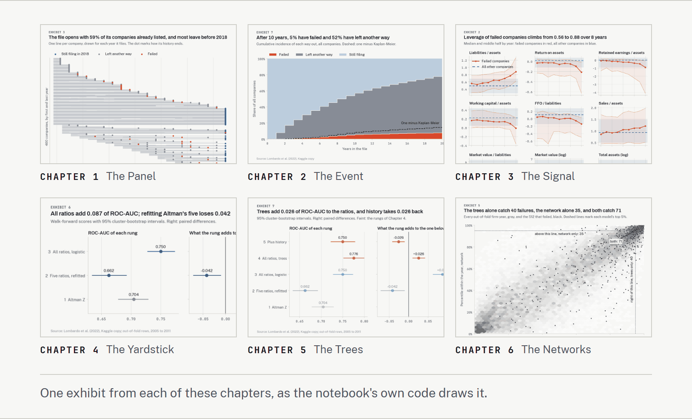
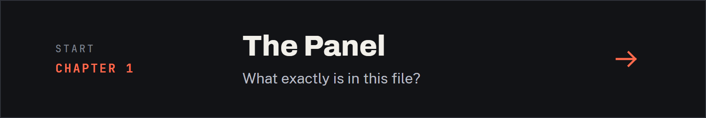

<!-- hero:start -->

<!-- hero:end -->

[Start here](#start-here) · [The seven chapters](#the-seven-chapters) · [What the evidence says](#what-the-evidence-says) · [A look inside](#a-look-inside) · [Method](#method) · [Limitations](#limitations) · [Quick Start](#quick-start) · [Dataset](#dataset)

<!-- numbers:start -->

<!-- numbers:end -->


A casebook on corporate default prediction, built on a free public panel of US listed companies.
It teaches how a default model is built and, above all, how it is honestly evaluated: the label, the split, the yardstick, and a holdout that is opened once.

Each chapter is a notebook that asks one question, shows its evidence as exhibits, sets the naive number beside the honest one, and can be rebuilt with one command.
The reader is assumed to know Python and basic finance.

> This casebook is educational content created in a personal capacity
>
> Nothing here is investment advice or a recommendation to buy or sell any security
>
> The data is a public research dataset with anonymised company names

## Start Here

<a href="data/README.md"></a>
<a href="notebooks/01_the_panel.ipynb"></a>
<a href="notebooks/07_the_verdict.ipynb"></a>

## The Seven Chapters



<!-- chapters:start -->
| Chapter | The question | What you learn |
| --- | --- | --- |
| [1. The Panel](notebooks/01_the_panel.ipynb) | What exactly is in this file? | Read a panel before modelling it: who is in it, when, and what the columns can say |
| [2. The Event](notebooks/02_the_event.ipynb) | What does failed mean, and when did it happen? | Turn a company-level flag into a dated event, and count the exits that are not failures |
| [3. The Signal](notebooks/03_the_signal.ipynb) | Where in the accounts does failure show, and how early? | Find where failure shows in the accounts, how early, and how the ground shifts |
| [4. The Yardstick](notebooks/04_the_yardstick.ipynb) | How will we know a model is good? | Build the yardstick first: splits by time, an embargo, ranking metrics, honest intervals |
| [5. The Trees](notebooks/05_the_trees.ipynb) | What do non-linearity and history buy? | Tune boosted trees without fooling yourself, and test what history adds |
| [6. The Networks](notebooks/06_the_networks.ipynb) | Can a network read a company's history? | Prepare inputs for a network, train it repeatably, and read a term structure of default |
| [7. The Verdict](notebooks/07_the_verdict.ipynb) | What does the sealed holdout say? | Open a sealed holdout once, calibrate, explain the score, and state the limits |
<!-- chapters:end -->

## What the Evidence Says

The spine of the casebook is one exhibit, the ladder.
It asks where the predictive power comes from, one rung at a time: a published score, the same ratios refitted, every ratio in a logistic regression, boosted trees, a company's history, a network, and a blend.

Every choice is made on a walk-forward over the development years.
The later years stay sealed until the last chapter, where each rung is scored on them once.

<!-- evidence:start -->


The holdout is the observation years 2014 to 2016: 9,954 firm-years with 160 failures, opened once.

The chosen model, "All ratios, trees", has a ROC-AUC of 0.815 there, with a 95% interval from 0.779 to 0.850.
On the walk-forward that chose it, it scored 0.776.

The published Altman Z scores 0.716 on the same rows.
The paired difference is +0.099, with an interval from +0.063 to +0.136.

Reviewing the top 5% of each year finds 35.6% of the failures, with an interval from 27.0% to 43.6%, a lift of 7.1 over names picked at random.

On companies the model never saw in training, it scores 0.722.
<!-- evidence:end -->

<!-- results:start -->
| Rung | Model | Walk-forward ROC-AUC | Holdout ROC-AUC | 95% interval | Step from the rung below | Average precision | Top 5% finds | Lift |
| --- | --- | --- | --- | --- | --- | --- | --- | --- |
| 1 | Altman Z | 0.704 | 0.716 | 0.676 to 0.753 |  | 0.029 | 5.6% | 1.1 |
| 2 | Five ratios, refitted | 0.662 | 0.743 | 0.705 to 0.780 | +0.027 (-0.014 to +0.071) | 0.035 | 6.2% | 1.2 |
| 3 | All ratios, logistic | 0.750 | 0.779 | 0.733 to 0.817 | +0.035 (+0.004 to +0.064) | 0.063 | 24.4% | 4.9 |
| 4 | **All ratios, trees** (chosen) | 0.776 | 0.815 | 0.779 to 0.850 | +0.037 (+0.007 to +0.071) | 0.119 | 35.6% | 7.1 |
| 5 | Plus history | 0.750 | 0.828 | 0.795 to 0.861 | +0.013 (-0.004 to +0.026) | 0.125 | 33.1% | 6.6 |
| 6 | Network, all ratios | 0.742 | 0.814 | 0.777 to 0.851 | -0.014 (-0.037 to +0.011) | 0.142 | 37.5% | 7.5 |
| 7 | Blend, trees and network | 0.771 | 0.821 | 0.785 to 0.855 | +0.007 (-0.002 to +0.015) | 0.152 | 37.5% | 7.5 |
<!-- results:end -->

Three things in that table deserve a plain statement.

- The chosen model is not the highest rung on the holdout. It was chosen on the walk-forward, before the holdout was opened, and it stays the chosen model.
- The broad order holds on both samples and the fine order does not. With this many failures the holdout can separate models that are far apart, and it cannot settle a step of a hundredth.
- Every rung scores higher on the holdout than on the walk-forward. The holdout holds no recession and the final models train on more years, so levels are not compared across the two samples.

## A Look Inside



## How a Chapter Works

| Part | What it does |
| --- | --- |
| The question | Each chapter opens on one question and says what you will be able to do by the end |
| Desk questions | Every step is a question, a code cell, and a short reading of what the output shows |
| Predict | Before a key result you are asked to commit to an answer |
| Pitfall | Where a naive analysis gives a different number, both are computed and shown side by side |
| Exhibits | Every chart states its finding in its title, with the number computed by the cell that drew it |
| Check | Short questions with the answer folded away |
| Your turn | Three extensions at the end, each with a hint |

No number in a notebook's text is typed by hand.
A cell stores it, and the build writes it into the sentence.

## Method

- **The label.** The file marks a company as failed, with no date. The casebook dates the event by the company's last filing and asks, of each firm-year, whether that last filing comes within two years.
- **The split.** Development years for every choice, a two-year embargo, then a holdout. Inside the development years a walk-forward validates on one year at a time, each fold trained only on years whose labels were settled before it.
- **The ranking.** Scores are ranked within each year, since a desk reviews a share of its names each year.
- **The yardstick.** ROC-AUC, average precision, and the share of failures found at fixed review budgets, each with an interval from resampling whole companies. Models are compared by paired differences on the same resamples.
- **The preprocessing.** Clipping bounds, fill values, and transforms are fitted on the training rows of each fold.
- **The choice.** Rules are written before their results: the highest mean average precision over the folds, and the simpler model unless a more complex one beats it with an interval above zero.
- **The holdout.** One function returns the holdout rows, and it refuses unless told to unseal. Only Chapter 7 does, in one cell, after the models, the choice, and the primary comparison were committed.
- **The library.** The analysis code lives in `src/corp_default/` under test. Each function is typed in full in the chapter that teaches it, and a test keeps the two copies identical.

## Limitations

The label:

- It is derived, not given. The year of failure is taken to follow the last filing, on the source paper's own rule.
- Bankruptcy is not default. A missed coupon or a distressed exchange is not in the file.
- A company that stops filing without failing is counted as a survivor.
- Some failures at the end of the file cannot be confirmed by a later row.

The sample:

- These are small listed companies, not a universe of bond issuers.
- Early failures are thin, and the dot-com bust is never a validation year.
- Most holdout firm-years belong to companies the model trained on, and it ranks companies it never saw less well.
- Market value is among the inputs, so this is a market and accounting model.
- Clipping bounds come from the development years, and later, larger companies press against them.

The evidence:

- The holdout years have been scored more than once in the making of this study, so the walk-forward is the primary evidence and the holdout a check on it.
- The holdout holds no recession, and the evidence under stress comes from crisis folds that also took part in selection.
- Those crisis folds have the smallest training sets, so stress and sample size cannot be told apart.
- The panel holds one crisis.
- The holdout supports a coarse ordering of models, not gains from rung to rung.
- The final model is several years old when the holdout scores it.
- The probability of default is an average over the cycle and will be wrong in most single years.

Chapter 7 measures each of these where the file allows.

## Quick Start

The project is managed with [uv](https://docs.astral.sh/uv/).
You do not need to install Python first: uv reads `.python-version` and fetches it.

### 1. Clone and register the kernel

```bash
git clone https://github.com/lenamonj/corp-default.git
cd corp-default
uv run python -m ipykernel install --user --name corp-default --display-name "corp-default (uv)"
```

`uv run` creates `.venv`, installs every package pinned in `uv.lock`, and registers a Jupyter kernel named `corp-default`.
Every notebook asks for that kernel by name.

### 2. Get the data

```bash
uv run python -m tools.get_data
```

The command downloads the file, checks it against a recorded hash, and writes `data/american_bankruptcy.csv` and `data/industry.csv`.
[The data page](data/README.md) says where each comes from.

### 3. Read and run

```bash
uv run jupyter lab notebooks/
```

Run every `uv` command from the repo root, the folder that holds `pyproject.toml`.
The notebooks are saved with their outputs, so they can also be read on GitHub without running anything.

In VS Code, open a notebook and choose **corp-default (uv)** in the kernel picker at the top right.
If the kernel is not in the list, run **Developer: Reload Window** from the Command Palette, since the list is read when VS Code starts.

### 4. Rebuild everything

```bash
uv run python -m playwright install chromium
uv run python -m tools.casebook.build --all
uv run pytest -q
```

The build executes each chapter from its source in `chapters/`, fills every number in the text from the cell that computed it, draws the design, and writes the notebook.
Chapters hand tables to each other through `artifacts/`, so they build in order.

A rebuild is repeatable.
In a fresh clone, with these commands, two builds in a row wrote the same notebooks, results, and hand-off tables, byte for byte, and both matched the committed files.

That was checked on Windows, on a CPU, with the library versions in `uv.lock`.
It has not been checked on another machine.

## Dataset

Lombardo, G., Pellegrino, M., Adosoglou, G., Cagnoni, S., Pardalos, P. M., Poggi, A. (2022). Machine Learning for Bankruptcy Prediction in the American Stock Market: Dataset and Benchmarks. *Future Internet* 14(8):244. [doi:10.3390/fi14080244](https://doi.org/10.3390/fi14080244)

The casebook reads the copy on [Kaggle](https://www.kaggle.com/datasets/utkarshx27/american-companies-bankruptcy-prediction-dataset) and the industry codes from the authors' own repository.
The data is not redistributed here.

[SOURCES.md](SOURCES.md) lists every external fact the casebook uses, with its link and the date it was read.

## Project Structure

```text
.
├── notebooks/            # what a reader opens: seven built, executed chapters
├── chapters/             # what a person edits: chapter sources and plans
├── src/corp_default/     # the tested library the chapters import
├── tools/casebook/       # the design system and the build
├── tools/get_data.py     # one-command fetch of the data
├── results/              # the numbers this page quotes, written by Chapter 7
├── tests/                # the library, the chapter standard, the design, this page
├── data/README.md        # where the data comes from; the files are not committed
├── SOURCES.md            # every external fact, with its link
└── pyproject.toml, uv.lock, .python-version
```

## License

The code is under the [MIT License](LICENSE).
The dataset is the authors' and is not part of this repository.

<a href="notebooks/01_the_panel.ipynb"></a>
